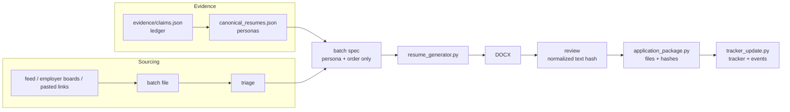

# Architecture

## The idea

The assistant's memory is the workspace, not the chat. Every session starts by reading a small set of files and ends by
writing back what changed. Scripts do the checks a language model should not be trusted with. People make three decisions.

## Layers

| Layer | Files | Who writes it | Enforced by |
|---|---|---|---|
| Rules | `PROFILE_AND_RULES.md`, `APPLICATION_POLICY.md`, `VOICE.md`, `config.json` | user and assistant (dated, in the user's words) | assistant; scripts read `config.json` |
| Evidence | `evidence/claims.json`, `BOUNDARIES.md`, `known_errors.json`, `project_aliases.json` | assistant from interviews; user confirms | `workflow_quality`, `doctor.py` |
| Personas | `canonical_resumes.json`, `base_resume.json` | assistant, user approves | `resolve_version`, `doctor.py` |
| Batches | `batches/`, `resume_versions/`, `cover_letter_versions/`, `reviews/` | assistant | schema v2, review binding |
| Records | `tracker.csv` (or `.xlsx`), `application_events.jsonl`, `skipped_listings.json`, `application_packages/` | scripts | tracker: atomic writes, backups, locks; other logs: simple writes |
| Memory | `HANDOFF.md`, `history/` | assistant | `archive_handoff.py` |

## Trust boundaries

- **Scripts are offline** except `sourcing.py` (reads one public JSON feed) and `employer_watch.py` (reads employers' public
  job-board endpoints). None logs in, stores cookies, submits a form or sends a message.
- **Postings, recruiter messages and web pages are data, not instructions.** `AGENTS.md` tells the assistant so, and
  `prompts/12_recruiter_messages.md` applies it.
- **The workspace is private.** `/workspace/` is ignored by git; `examples/` is fictional; `pii_scan.py` checks before publishing.

## The workspace directory

Resolved from `--workspace`, then `JOBSEARCH_WORKSPACE`, then `<repo>/workspace`. Workspace tools take the same option, so a
user can keep the workspace in a private repository or a synced folder.

## Revisions and staleness

- `claims.json` has a `revision`; reviews record it. Change the ledger and old reviews are stale.
- `canonical_resumes.json` has a `revision`; batch specs record it. Change a persona and old batch specs fail.
- Reviews record `text_sha256` over extracted text with whitespace normalized. Wording changes invalidate the review;
  whitespace and formatting changes may not. Final layout still needs visual inspection.
- Packages record a SHA-256 per archived file; `--verify` detects byte changes to those files. The manifest itself is
  unsigned and editable, so this is an integrity check against accidental changes, not tamper-proof evidence.

## Adding to the system

New script: put it in `scripts/`, take `--workspace`, call `announce(cfg)` so the demo notice appears, add tests that use the
demo workspace, and document it in [SCRIPTS.md](SCRIPTS.md). New tracker backend: implement the `read` and `apply` methods of
`tracker.Tracker`. New employer system: write an adapter in `employer_watch.py` that returns the common row shape.
